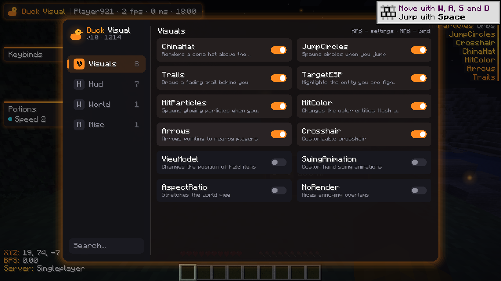
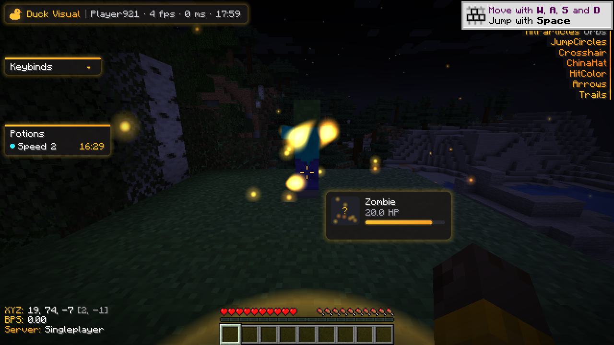
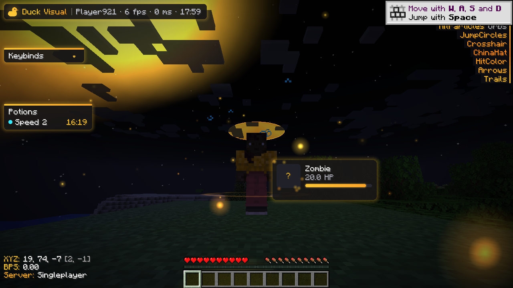

# 🦆 Duck Visual — 1.21.4

Клиентский визуальный мод для Minecraft **1.21.4** (Fabric) в стиле Pulse Visual:
ClickGUI, HUD, China Hat, Jump Circles, Trails, Target ESP, Hit Particles, кастомный прицел
и многое другое. Мод полностью клиентский, на сервер ничего не отправляет.

## Установка

1. Установите [Fabric Loader](https://fabricmc.net/use/) для **1.21.4** (0.16.10+).
2. Положите в `.minecraft/mods`:
   - `duck-visual-1.0.0.jar` (из `build/libs` после сборки)
   - [Fabric API](https://modrinth.com/mod/fabric-api) для 1.21.4
3. Запустите игру и нажмите **Right Shift**.

## Управление в меню

| Действие | Кнопка |
|---|---|
| Открыть / закрыть меню | `Right Shift` (можно перебиндить у модуля ClickGui) |
| Включить / выключить модуль | ЛКМ по карточке |
| Открыть настройки модуля | ПКМ по карточке |
| Забиндить модуль | СКМ по карточке → нажать клавишу (`Esc`/`Backspace` = убрать бинд) |
| Переключить режим | ЛКМ — вперёд, ПКМ — назад |
| Двигать HUD | Зажать ЛКМ на элементе HUD при открытом меню |
| Поиск | Поле `Search...` внизу слева |

Конфиг сохраняется автоматически в `.minecraft/config/duckvisual.json`.

## Модули

**Visuals**
- **ChinaHat** — конус-шляпа над головой (градиент темы, обводка, на других игроках).
- **JumpCircles** — круги при прыжке (Glow / Ring / Wave).
- **Trails** — след за игроком (Ribbon / Line / Orbs).
- **TargetESP** — подсветка цели (Ghosts / Circle / Marker / Souls), краснеет при ударе.
- **HitParticles** — частицы при ударе (Orbs / Stars / Hearts / Cubes) с физикой.
- **HitColor** — цвет «покраснения» мобов при уроне (цвет темы или свой).
- **Arrows** — стрелки вокруг прицела на ближайших игроков.
- **Crosshair** — кастомный прицел (Cross / Circle / Dot), динамика и кулдаун атаки.
- **ViewModel** — позиция и размер предметов в руках.
- **SwingAnimation** — анимации удара (Smooth / Block / Slide / Spin / Punch / Down) и скорость.
- **AspectRatio** — растянутое разрешение.
- **NoRender** — убрать тряску при уроне, огонь, тыкву, тошноту, боссбар, скорборд, иконки эффектов.

**Hud**
- **Watermark** — лого Duck Visual, ник, FPS, пинг, время.
- **ArrayList** — список включённых модулей с анимацией.
- **Keybinds** — список биндов.
- **Potions** — активные эффекты зелий.
- **TargetHud** — информация о цели: голова, HP-бар, броня, частицы.
- **Information** — координаты (+ координаты Незера), скорость, сервер.
- **Notifications** — уведомления о включении/выключении модулей.

**World**
- **Fullbright** — полная яркость.
- **TimeChanger** — время суток на клиенте (фикс. или цикл).
- **WorldParticles** — светящиеся частицы вокруг (Fireflies / Snow / Rise).

**Misc**
- **Theme** — цвета клиента: Gradient / Static / Rainbow, два цвета, скорость.
- **ClickGui** — бинд меню, затемнение фона, описания.

## Сборка

Нужна Java 21.

```bash
./gradlew build
```

Готовый мод: `build/libs/duck-visual-1.0.0.jar`.

Готовая сборка лежит в [`release/duck-visual-1.0.0.jar`](release/duck-visual-1.0.0.jar).

## Скриншоты




